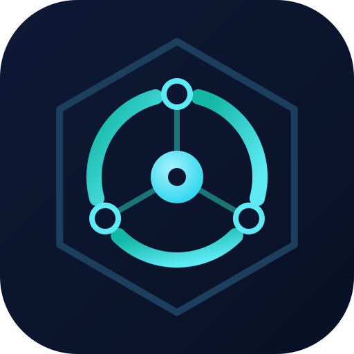
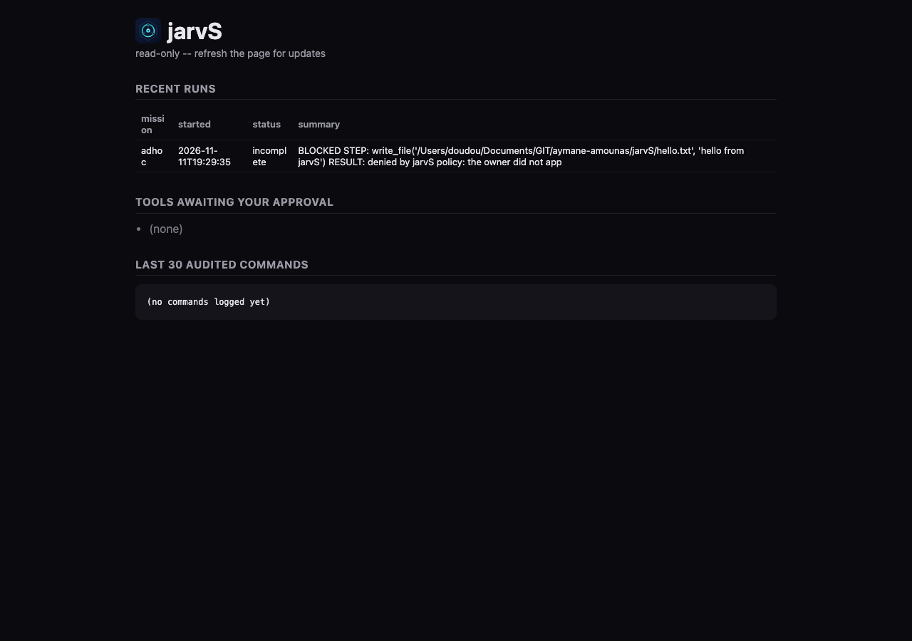
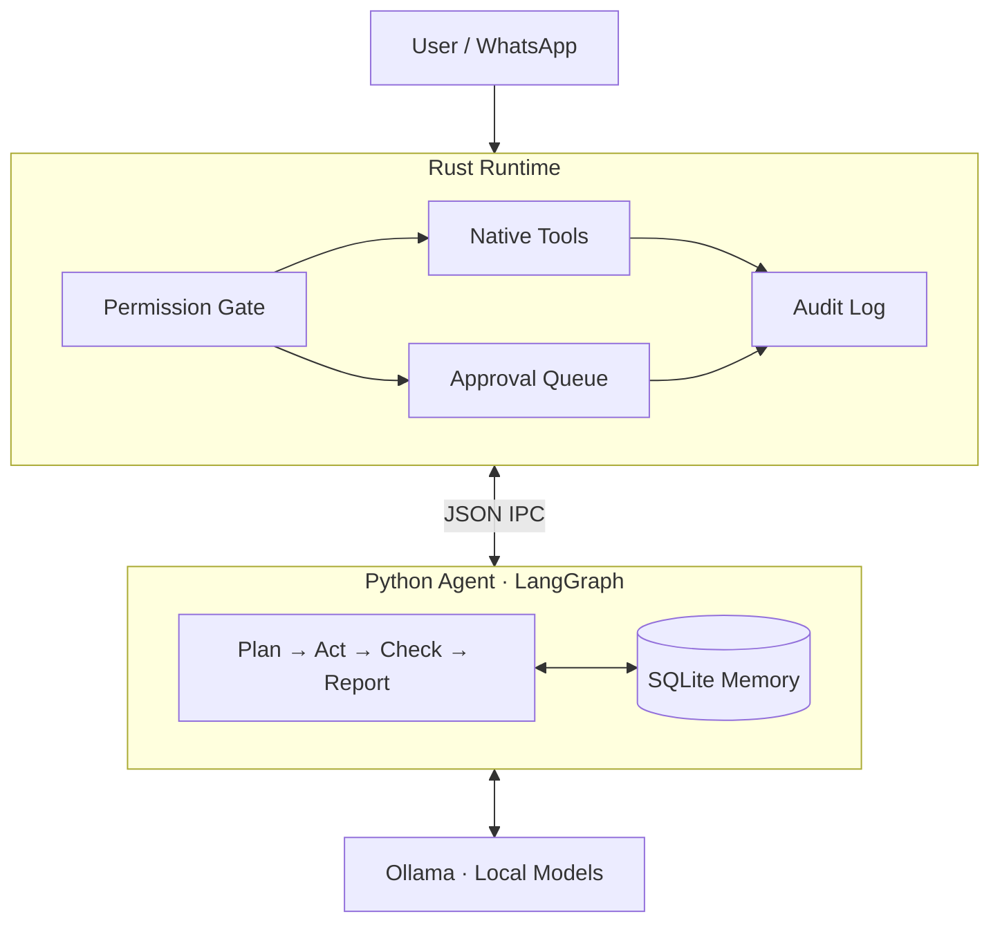

# jarvS

<p align="center">
  
</p>

<h3 align="center">Your machine. Your AI. Your rules.</h3>

<p align="center">
  A local-first AI agent built for autonomy, privacy, and control.
</p>

<p align="center">
  <a href="LICENSE"></a>
  
  
  
</p>

---

## What is jarvS?

jarvS is a personal AI agent that can think, use tools, manage tasks, and work autonomously on your machine.

It combines a **Rust execution runtime** with a **Python reasoning agent** powered by LangGraph and local language models through Ollama.

Unlike a typical AI wrapper, jarvS separates intelligence from execution.

The model proposes actions. The Rust runtime decides whether they happen.

**Autonomy without giving up control.**

## At a glance

| Name | What it does | Stack | Demo |
|---|---|---|---|
| **jarvS** | Local-first personal AI agent: Python reasoning, Rust-gated execution, permissioned tools, WhatsApp control | Rust · Python · LangGraph · Ollama · SQLite | [Recorded session](docs/DEMO.md) · [See it run](#see-it-run) |

> No hosted link: jarvS runs on your own machine. The reproducible local demo is the recorded session in [`docs/DEMO.md`](docs/DEMO.md), summarized with a dashboard screenshot under [See it run](#see-it-run).

## See it run

<p align="center">
  
</p>

A recorded session ([docs/DEMO.md](docs/DEMO.md)) on an 8 GB Apple M3 with a 3B local model: the agent tries to write a file outside its workspace, the call is held for approval, the workspace guard still blocks it after approval, a retry is denied, and every decision lands in the audit log.

```console
$ jarvs run 'Create a file named hello.txt in the workspace containing the text: hello from jarvS'
  [start] graph
  tool get_system_state: Executed
  approval needed: write_file(content=<16 chars>, path=".../jarvS/hello.txt")  -> `jarvs approve 18e7…` or `jarvs deny 18e7…`
  tool write_file: Executed            # approved, but outside the workspace: nothing written
  approval needed: write_file(...)     # model retries
  tool write_file: Denied
status: Incomplete, 3 tool call(s)
```

## Features

- **Local AI:** Run models through Ollama, with separate planning and fast models.
- **Controlled execution:** Every tool call passes through the Rust runtime.
- **Permission system:** Allow, approve, or deny individual capabilities.
- **Human approval:** Review sensitive actions before execution.
- **Autonomous missions:** Schedule recurring objectives with configurable work cycles.
- **Persistent memory:** SQLite-backed history, journal, queues, and mission state.
- **Messaging:** Send tasks and receive results through WhatsApp.
- **Web research:** Search the web, news, and fetch public pages.
- **Hardware awareness:** Inspect system resources and estimate suitable model sizes.
- **Audit logging:** Record execution decisions without storing message bodies or file contents.
- **Dashboard:** Inspect recent activity through a local, read-only interface.

## Architecture

jarvS has three main layers:



| Layer | Responsibility |
|---|---|
| Rust | Execution, permissions, approvals, supervision, system access |
| Python | Reasoning, planning, memory, missions |
| Ollama | Local model inference |

The Python agent never executes native tools directly. It requests actions through a JSON-based IPC protocol, and Rust makes the execution decision.

## Quick start

### Requirements

- Rust 1.85+
- Python 3.11+
- Ollama
- Git
- An Ollama model

### 1. Clone

```bash
git clone https://github.com/aymane-amounas/jarvS.git jarvs
cd jarvs
```

### 2. Build

```bash
cargo build --release
```

### 3. Set up the agent

```bash
python3 -m venv .venv
.venv/bin/pip install -r requirements.txt

cp env.example .env
cp missions.example.yaml missions.yaml
```

### 4. Pull a model

```bash
ollama pull qwen3:4b
```

Configure your models in `.env`:

```env
JARVIS_PLAN_MODEL=qwen3:4b
JARVIS_FAST_MODEL=qwen3:4b
```

### 5. Run

```bash
./target/release/jarvs status
./target/release/jarvs hardware
./target/release/jarvs run "Summarize my project status"
```

## Installation

For a complete setup, review the configuration files and local runtime docs in this repository:

- `env.example` for environment variables and model selection
- `missions.example.yaml` as the starting point for autonomous work
- `docs/ARCHITECTURE.md` and `docs/IPC_PROTOCOL.md` for runtime and protocol details
- `docs/PROJECT_AUDIT.md` for current security protections and known limitations

## Commands

| Command | Description |
|---|---|
| `jarvs run "task"` | Execute a task |
| `jarvs daemon` | Run the background worker |
| `jarvs status` | Check runtime status |
| `jarvs hardware` | Inspect system resources |
| `jarvs tools` | Inspect tool permissions |
| `jarvs approvals` | View pending approvals |
| `jarvs approve <id>` | Approve an action |
| `jarvs deny <id>` | Deny an action |
| `jarvs config show` | Inspect configuration |

## Security by design

jarvS is designed around a simple principle: **the model is not the authority.**

- Every native tool call passes through Rust.
- File operations are confined to a designated workspace.
- Sensitive operations require explicit approval.
- Arbitrary shell execution is denied.
- Private network and metadata addresses are blocked by the web-fetch tool.
- Tool decisions are recorded in an audit log.
- Untrusted web content is treated as data, not instructions.

Security boundaries are enforced by the runtime rather than relying on prompt instructions.

See [Security boundaries](docs/SECURITY.md) for platform-specific guarantees and limitations, and the [Project Audit](docs/PROJECT_AUDIT.md) for implementation context.

## Platform support

| Platform | Runtime and CI | Installer |
|---|---|---|
| Linux | Tested in CI | Ubuntu + systemd |
| macOS | Tested in CI | Manual |
| Windows | Tested in CI | Manual |

CI runs the Rust and Python test suites on all three platforms on every push.

**Hardware actually tested end to end:** Apple M3, 8 GB unified memory, macOS 27.2, Ollama with `qwen2.5-coder:3b` ([session](docs/DEMO.md)). Linux and Windows have passed CI but have not had a full end-to-end run with a local model yet.

CI coverage does not imply that every integration is supported on every platform.

## Documentation

- [Architecture](docs/ARCHITECTURE.md)
- [IPC Protocol](docs/IPC_PROTOCOL.md)
- [Implementation Status](docs/IMPLEMENTATION_STATUS.md)
- [Roadmap](docs/ROADMAP.md)
- [Security boundaries](docs/SECURITY.md)
- [Project Audit](docs/PROJECT_AUDIT.md)
- [Third-party Licenses](docs/THIRD_PARTY.md)
- [Contributing](CONTRIBUTING.md)

## License

The Aymane Amounas Noncommercial Attribution License 1.0 applies to this
version. See [LICENSE](LICENSE) for noncommercial permissions, commercial-use
restrictions, required attribution for source and binary distributions,
third-party terms, and the exception for private employee experimentation
unconnected to employer work, resources, accounts, data, or benefit. See
[NOTICE](NOTICE) for notice guidance and [CONTRIBUTING.md](CONTRIBUTING.md) for
contributor terms.

Required attribution:

> Based on jarvS by Aymane Amounas<br>
> <https://github.com/aymane-amounas/jarvS>

Because commercial use is restricted, this is source-available software, not
OSI-approved open-source software.

Earlier versions distributed under Apache License 2.0 remain available under
that license.

Copyright © 2026 Aymane Amounas.

---

<p align="center">
  Built with curiosity. Engineered with purpose.
</p>

<p align="center">
  <sub>Built by <a href="https://github.com/aymane-amounas/jarvS">Aymane</a></sub>
</p>