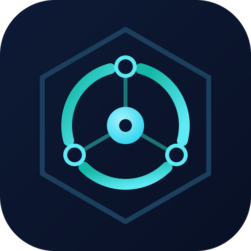
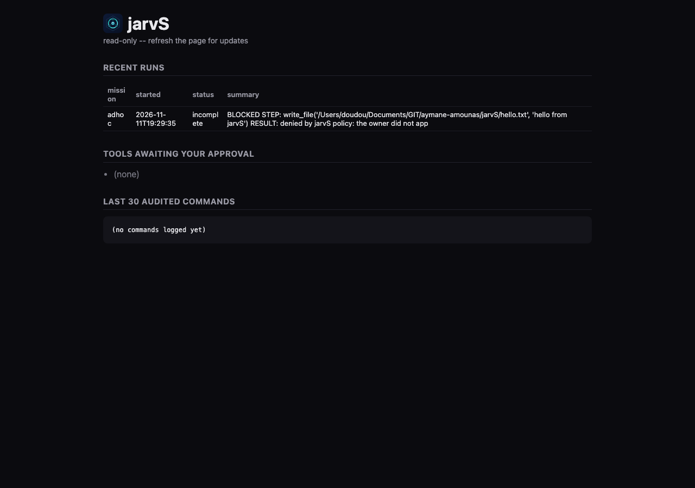
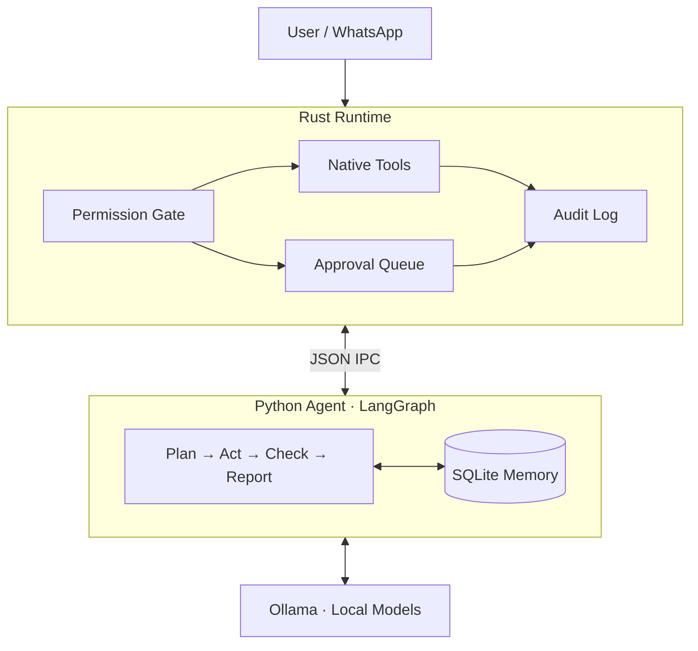

# jarvS

<p align="center">
  
</p>

<p align="center">
  A local-first personal AI agent that runs on your own machine, under your own rules.
</p>

<p align="center">
  <a href="LICENSE"></a>
  
  
  
</p>

---

## What jarvS is

jarvS is a personal AI agent that can reason, use tools, manage tasks, and work
on its own on your machine. The reasoning runs in Python on top of LangGraph and
a local model served by Ollama. The execution runs in a Rust runtime that sits
in front of every action the agent wants to take.

The reason I split it that way is simple: I did not want the model to be the
thing that decides what actually happens. The model proposes an action, and the
Rust runtime decides whether it runs. So the agent can work without supervision,
but it cannot step outside the boundaries the runtime enforces.

## At a glance

| Name | What it does | Stack | Demo |
|---|---|---|---|
| **jarvS** | Local-first personal AI agent: Python reasoning, Rust-gated execution, permissioned tools, WhatsApp control | Rust · Python · LangGraph · Ollama · SQLite | [Recorded session](docs/DEMO.md) · [See it run](#see-it-run) |

> There is no hosted link, because jarvS runs on your own machine. The closest
> thing to a live demo is the recorded session in [`docs/DEMO.md`](docs/DEMO.md),
> summarized with a dashboard screenshot under [See it run](#see-it-run).

## See it run

<p align="center">
  
</p>

Here is a recorded session ([docs/DEMO.md](docs/DEMO.md)) on an 8 GB Apple M3
with a 3B local model. The agent tries to write a file outside its workspace,
the call is held for approval, the workspace guard still blocks it after
approval, a retry is denied, and every decision lands in the audit log.

```console
$ jarvs run 'Create a file named hello.txt in the workspace containing the text: hello from jarvS'
  [start] graph
  tool get_system_state: Executed
  approval needed: write_file(content=<16 chars>, path=".../jarvS/hello.txt")  -> `jarvs approve 18e7…` or `jarvs deny 18e7…`
  tool write_file: Executed            # approved, but outside the workspace: nothing written
  approval needed: write_file(...)     # model retries
  tool write_file: Denied
status: Incomplete, 3 tool call(s)
```

## Features

- Local inference through Ollama, with separate planning and fast models.
- Every tool call passes through the Rust runtime before it runs.
- A permission system that can allow, require approval for, or deny each capability.
- Human approval for sensitive actions, reviewed before they execute.
- Autonomous missions: recurring objectives on a configurable work cycle.
- Persistent memory in SQLite: history, journal, queues, and mission state.
- Messaging over WhatsApp, so you can send tasks and get results.
- Web research: search the web and news, and fetch public pages.
- Hardware awareness: it inspects system resources and estimates a model size that fits.
- Audit logging that records execution decisions without storing message bodies or file contents.
- A local, read-only dashboard for inspecting recent activity.

## Feature maturity

I try to be honest here about what has actually run. Implemented means built and
covered by tests or a recorded run. Experimental means it works but has a known
limitation. Planned means not built yet.

| Capability | Status | Evidence |
|---|---|---|
| Rust execution runtime (supervisor, handshake, timeout, cancel, kill) | Implemented | `jarvs-core/worker.rs`, `jarvs-cli/tests/cli.rs` (real binary + Python) |
| Permission control (allow / approval / deny, shell locked off) | Implemented | `jarvs-core/permissions.rs` unit tests |
| Workspace guard (traversal, absolute, symlink, sensitive names; re-checked after approval) | Implemented | `jarvs-core/workspace.rs`, `tools.rs` confinement tests |
| Web research (native `fetch`, `search_web`, `search_news`; SSRF-guarded, private/metadata IPs blocked at resolution) | Implemented | `jarvs-core/web.rs` unit + live tests |
| Local inference via Ollama (separate plan and fast models) | Implemented | `llm.py`; recorded M3 session in [docs/DEMO.md](docs/DEMO.md) |
| Persistent missions and autonomous work cycle | Implemented | `graph.py` decide loop, `worker.py` cycle, `memory.py` runs/journal |
| Audit logging (decisions only, no argument values) | Implemented | `jarvs-core/audit.rs` unit + CLI tests |
| Read-only dashboard | Implemented | `dashboard.py`; screenshot above |
| Custom Python tools (syntax-restricted, test-gated, OS-sandboxed) | Experimental | macOS Seatbelt / Linux Bubblewrap; Windows disabled, fails closed. Not independently assessed. See [docs/SECURITY.md](docs/SECURITY.md) |
| Messaging integrations (WhatsApp in, replies out) | Experimental | `channels/wa.py` + Baileys bridge; the legacy channel loop runs outside the Rust gate |
| Email (Gmail) and browser automation | Planned | `gmail_setup.py` OAuth helper only; Playwright installed but not wired to a tool |

## jarvS and Venus Agent

A quick note on naming, because it comes up. jarvS is the assistant: the
opinionated personal agent you run on your own machine, with WhatsApp control,
standing missions, and a fixed set of tools.

Venus is the name I use for the reusable part underneath that idea, the piece
that is actually interesting to lift out on its own: the permission gate, the
IPC boundary, and native tool execution as a library other projects could build
on. For now it lives inside this repo rather than as a separate library. jarvS
is one application of it. So if you want the assistant, that is jarvS. If you
ever want to embed gated execution in your own agent, that is the part I think
of as Venus.

## Architecture

jarvS has three main layers.



| Layer | Responsibility |
|---|---|
| Rust | Execution, permissions, approvals, supervision, system access |
| Python | Reasoning, planning, memory, missions |
| Ollama | Local model inference |

The Python agent never runs a native tool directly. It asks for an action over
a JSON-based IPC protocol, and Rust makes the call on whether it happens.

## Quick start

### Requirements

- Rust 1.85+
- Python 3.11+
- Ollama
- Git
- An Ollama model

### 1. Clone

```bash
git clone https://github.com/aymane-amounas/jarvS.git jarvs
cd jarvs
```

### 2. Build

```bash
cargo build --release
```

### 3. Set up the agent

```bash
python3 -m venv .venv
.venv/bin/pip install -r requirements.txt

cp env.example .env
cp missions.example.yaml missions.yaml
```

### 4. Pull a model

```bash
ollama pull qwen3:4b
```

Then point your models at it in `.env`:

```env
JARVIS_PLAN_MODEL=qwen3:4b
JARVIS_FAST_MODEL=qwen3:4b
```

### 5. Run

```bash
./target/release/jarvs status
./target/release/jarvs hardware
./target/release/jarvs run "Summarize my project status"
```

## Installation

For a full setup, the configuration files and runtime docs in this repo are the
place to look:

- `env.example` for environment variables and model selection
- `missions.example.yaml` as the starting point for autonomous work
- `docs/ARCHITECTURE.md` and `docs/IPC_PROTOCOL.md` for the runtime and the protocol
- `docs/PROJECT_AUDIT.md` for the current security protections and known limitations

## Commands

| Command | Description |
|---|---|
| `jarvs run "task"` | Execute a task |
| `jarvs daemon` | Run the background worker |
| `jarvs status` | Check runtime status |
| `jarvs hardware` | Inspect system resources |
| `jarvs tools` | Inspect tool permissions |
| `jarvs approvals` | View pending approvals |
| `jarvs approve <id>` | Approve an action |
| `jarvs deny <id>` | Deny an action |
| `jarvs config show` | Inspect configuration |

## Security by design

The whole design rests on one idea: the model is not the authority. Concretely,
that means:

- Every native tool call passes through Rust.
- File operations are confined to a designated workspace.
- Sensitive operations require explicit approval.
- Arbitrary shell execution is denied.
- Private network and metadata addresses are blocked by the web-fetch tool.
- Tool decisions are recorded in an audit log.
- Untrusted web content is treated as data, not instructions.

These boundaries are enforced by the runtime, not by asking the model nicely in
a prompt.

See [Security boundaries](docs/SECURITY.md) for the platform-specific guarantees
and limitations, and the [Project Audit](docs/PROJECT_AUDIT.md) for the
implementation context.

## Platform support

| Platform | Runtime and CI | Installer |
|---|---|---|
| Linux | Tested in CI | Ubuntu + systemd |
| macOS | Tested in CI | Manual |
| Windows | Tested in CI | Manual |

CI runs the Rust and Python test suites on all three platforms on every push.

The only configuration I have actually run end to end is an Apple M3 with 8 GB
of unified memory, macOS 27.2, and Ollama with `qwen2.5-coder:3b`
([session](docs/DEMO.md)). Linux and Windows pass CI but have not had a full
end-to-end run with a local model yet, so CI coverage is not the same as saying
every integration works on every platform.

## Documentation

- [Architecture](docs/ARCHITECTURE.md)
- [IPC Protocol](docs/IPC_PROTOCOL.md)
- [Memory and stored state](docs/MEMORY.md)
- [Implementation Status](docs/IMPLEMENTATION_STATUS.md)
- [Roadmap](docs/ROADMAP.md)
- [Security boundaries](docs/SECURITY.md)
- [Project Audit](docs/PROJECT_AUDIT.md)
- [Third-party Licenses](docs/THIRD_PARTY.md)
- [Contributing](CONTRIBUTING.md)

## License

The Aymane Amounas Noncommercial Attribution License 1.0 applies to this
version. See [LICENSE](LICENSE) for noncommercial permissions, commercial-use
restrictions, required attribution for source and binary distributions,
third-party terms, and the exception for private employee experimentation
unconnected to employer work, resources, accounts, data, or benefit. See
[NOTICE](NOTICE) for notice guidance and [CONTRIBUTING.md](CONTRIBUTING.md) for
contributor terms.

Required attribution:

> Based on jarvS by Aymane Amounas<br>
> <https://github.com/aymane-amounas/jarvS>

Because commercial use is restricted, this is source-available software, not
OSI-approved open-source software.

Earlier versions distributed under Apache License 2.0 remain available under
that license.

Copyright © 2026 Aymane Amounas.

---

<p align="center">
  <sub>Built by <a href="https://github.com/aymane-amounas/jarvS">Aymane</a></sub>
</p>
