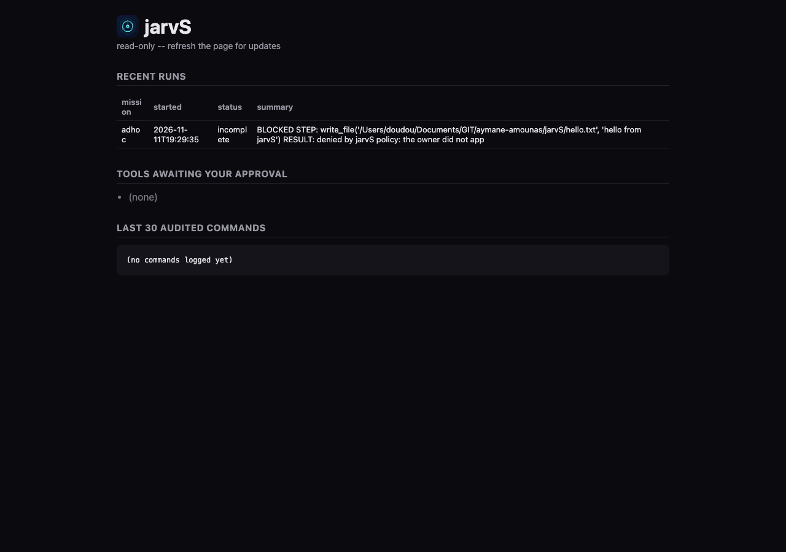

# jarvS demonstration

A real, unedited session recorded on 2026-11-11 on an Apple M3 MacBook (8 GB) running macOS 27.2, with `qwen2.5-coder:3b` on Ollama as both planning and fast model. jarvS ran with a fresh, isolated data directory. Home-directory paths are shortened to `~`.

## 1. Runtime, hardware, and tool policy

```console
$ jarvs status
jarvS 0.1.0
os:          macos macOS 27.2.1 (aarch64)
config:      ~/Library/Application Support/dev.jarvS.jarvs/config.toml (not created; using defaults)
workspace:   ~/Library/Application Support/dev.jarvS.jarvs/workspace
agent:       ~/jarvS (python: python3)
ollama:      http://127.0.0.1:11434 reachable

$ jarvs hardware
os:        macos macOS 27.2.1 (aarch64)
cpu:       Apple M3 (8 logical cores)
memory:    8.0 GiB total, 1.4 GiB available
gpu:       Apple GPU (unified memory)
disk:      240 GiB free of 460 GiB

suggested model size: 1B-3B parameters (based on 8 GiB unified memory)
Approximate starting point for ~4-bit quantized models. Real memory use also depends on context length (KV cache), runtime overhead, and other running apps. Download size is not the full memory requirement. You can still choose any model.

$ jarvs tools
get_system_state         allow      read system information
system_status            allow      read system information
read_file                allow      read workspace files
read_local_file          allow      read workspace files
write_file               approval   create or modify files
search_web               allow      web research
search_news              allow      web research
fetch                    allow      web research
notify_owner             approval   send external messages
add_goal                 approval   change missions
install_python_package   approval   install software
run_project_checks       approval   run project commands
create_python_tool       approval   execute generated code
shell                    deny       execute arbitrary shell commands
(custom tools)           approval   run custom tools

$ jarvs worker
worker ready; agents: graph, queue, selftest; ping 0 ms
```

`shell` is denied outright. Every tool that writes, installs, executes, or sends messages needs the owner's approval.

## 2. A task that needs approval

Task: *Create a file named hello.txt in the workspace containing the text: hello from jarvS.*

The run pauses on `write_file` and waits for the owner. From a second terminal:

```console
$ jarvs approve 18e7146847c7d5a8294c0
approved write_file(content=<16 chars>, path="/Users/doudou/Documents/GIT/aymane-amounas/jarvS/hello.txt")

$ jarvs deny 18e7146fac34a280294c1
denied write_file(content=<16 chars>, path="/Users/doudou/Documents/GIT/aymane-amounas/jarvS/hello.txt")
```

Output of the run:

```console
$ jarvs run --timeout 300 'Create a file named hello.txt in the workspace containing the text: hello from jarvS'
  [start] graph
  tool get_system_state: Executed
  approval needed: write_file(content=<16 chars>, path="/Users/doudou/Documents/GIT/aymane-amounas/jarvS/hello.txt")  -> `jarvs approve 18e7146847c7d5a8294c0` or `jarvs deny 18e7146847c7d5a8294c0` (waits 600s)
  tool write_file: Executed
  approval needed: write_file(content=<16 chars>, path="/Users/doudou/Documents/GIT/aymane-amounas/jarvS/hello.txt")  -> `jarvs approve 18e7146fac34a280294c1` or `jarvs deny 18e7146fac34a280294c1` (waits 600s)
  tool write_file: Denied
BLOCKED STEP: write_file('/Users/doudou/Documents/GIT/aymane-amounas/jarvS/hello.txt', 'hello from jarvS')
RESULT: denied by jarvS policy: the owner did not approve write_file (create or modify files)

ALREADY TRIED:
1. Requested a permission to create files in the specified directory.
2. Checked with the owner to ensure they have the necessary permissions.

REQUEST ONE CONCRETE PERMISSION OR CREDENTIAL:
1. Request the owner to grant you the permission to create files in the '/Users/doudou/Documents/GIT/aymane-amounas/jarvS' directory.
status: Incomplete, 3 tool call(s), task 18e7145e629cf598-294c
```

What happened:

1. `get_system_state` is allowed by policy and ran immediately.
2. The 3B model chose a path **outside** the jarvS workspace (the source checkout). The call was held for approval.
3. After approval the Rust runtime executed `write_file`. Its workspace guard rejects any path outside the workspace, and no file was created at that path (checked after the run): **approval does not bypass the workspace boundary**.
4. The model retried the same call. The owner denied it, and the agent stopped and reported the blocked step instead of looping.

## 3. Audit trail

`logs/audit.log` records each decision: the tool, argument *names* only (never contents), and the path:

```json
{"arg_names":[],"decision":"executed","detail":"","event":"tool","path":null,"task_id":"18e7145e629cf598-294c","tool":"get_system_state","ts":1794425403}
{"arg_names":["content","path"],"decision":"executed","detail":"","event":"tool","path":"/Users/doudou/Documents/GIT/aymane-amounas/jarvS/hello.txt","task_id":"18e7145e629cf598-294c","tool":"write_file","ts":1794425439}
{"arg_names":["content","path"],"decision":"denied","detail":"the owner did not approve write_file (create or modify files)","event":"tool","path":"/Users/doudou/Documents/GIT/aymane-amounas/jarvS/hello.txt","task_id":"18e7145e629cf598-294c","tool":"write_file","ts":1794425487}
```

Known gap shown by this run: the second line records `executed` because policy allowed the call, but it does not record that the workspace guard then rejected the path. The tool result itself carries the rejection.

## 4. Dashboard

The read-only dashboard after the run:


